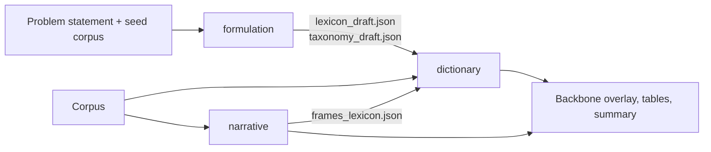
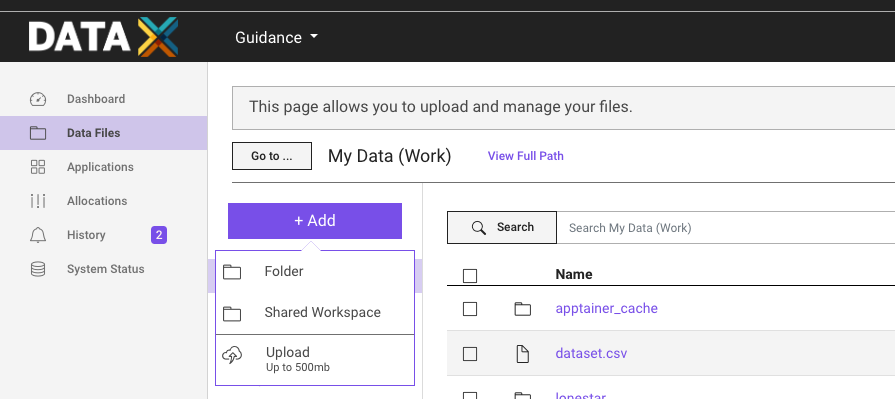
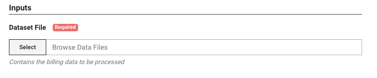
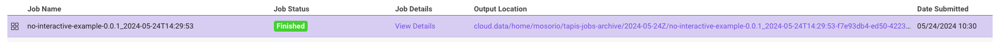

# Semantic Sensemaking

A Python library and set of TACC cookbook apps for making sense of document
collections — transcripts, papers, reports, notes — by placing what they talk
about on a shared **science backbone** (a taxonomy of research domains and
subdisciplines).

Three workflows share one set of tools:

| Workflow | Question it answers | Reads | Writes |
|---|---|---|---|
| **formulation** | *What concepts and vocabulary does our problem involve?* | a problem statement, a seed corpus | a draft lexicon and taxonomy |
| **dictionary** | *Where, and how much, does this collection talk about each concept?* | a corpus, a lexicon, a taxonomy | counts, backbone projection, figures |
| **narrative** | *What recurring stories or frames does this collection contain?* | a corpus, a taxonomy | frames, backbone projection, figures, frames as a lexicon |

They chain: formulation drafts the lexicon the dictionary workflow reads, and
narrative exports its frames as a lexicon the dictionary workflow can count
across other collections.



## Install

```bash
conda env create -f environment.yaml
conda activate semantic-sensemaking
python -m pip install -e ".[dev]"      # library + readers + figures + test tools
```

Optional extras: `readers` (`.docx`, `.pdf`), `viz` (Plotly figures), `embed`
(local Hugging Face embeddings, pulls in PyTorch), `llm` (Anthropic SDK), `all`.

## Quick start

Every workflow runs from the `semantic-sensemaking` command and writes one run
directory under `results/` containing CSV tables, a `summary.md`, a
`manifest.json` (inputs, hashes, versions, settings), and HTML figures where
relevant. These commands use the built-in sample corpus and need no model:

```bash
# Count the built-in SUBSIDE dictionary in the sample corpus
semantic-sensemaking dictionary --sample-corpus

# Find frames (hashing embeddings: checks the pipeline, frames are not meaningful)
semantic-sensemaking narrative --sample-corpus --set embedding.kind=hashing --set narrative.segment_words=40

# Check an existing lexicon against a seed corpus and write review drafts
semantic-sensemaking formulation --sample-corpus --lexicon my_lexicon.csv
```

With your own data and models, use a job file — annotated examples are in
[`configs/`](configs/):

```bash
semantic-sensemaking dictionary  --config configs/dictionary-example.yaml  --corpus path/to/docs
semantic-sensemaking narrative   --config configs/narrative-example.yaml   --corpus path/to/docs
semantic-sensemaking formulation --config configs/formulation-example.yaml --corpus path/to/seed_docs
```

Settings are layered: defaults < job file < `SSM_*` environment variables
(`SSM_CORPUS__MAX_FILES=50`) < command-line flags and `--set key=value`.
Unknown keys are errors. `semantic-sensemaking config show --workflow narrative ...`
prints the resolved settings; `semantic-sensemaking schema <dir>` writes JSON Schemas for
lexicon, taxonomy, and job files.

### Models

Embedding and chat models sit behind one interface, chosen in the `embedding`
and `chat` sections:

| `kind` | Embeddings | Chat | Notes |
|---|---|---|---|
| `openai_compatible` | yes | yes | Any `/v1` server: vLLM or Ollama on a TACC node, or a hosted API |
| `anthropic` | — | yes | Claude; reads `ANTHROPIC_API_KEY` (or `api_key_env`) |
| `huggingface_local` | yes | — | Needs the `embed` extra |
| `hashing` | yes | — | Deterministic and offline; for tests only |
| `none` | — | — | Default |

API keys are read from the environment variable named by `api_key_env` (default
`OPENAI_API_KEY` or `ANTHROPIC_API_KEY`); job
files and manifests hold the variable's name, never its value.

| Workflow | Embedding | Chat |
|---|---|---|
| dictionary | only for `scoring.method: semantic` or `mapping_method: embedding` | not used |
| narrative | required | optional (names frames; otherwise keywords) |
| formulation | only for semantic grounding or embedding mapping | required to draft a lexicon; not needed to check an existing one |

### Inputs

- **Corpus**: a folder of `.txt`, `.md`, `.json` transcripts (`text`, `content`,
  `chunks`, or `speakers` layouts), `.docx`, or `.pdf` with a text layer. Filter
  with `corpus.glob_patterns`, `corpus.max_files`, `corpus.min_chars`.
- **Lexicon**: JSON (`{"Group": ["term", ...]}` or the structured format) or CSV
  with `group,term` columns — see [`configs/lexicon-template.json`](configs/lexicon-template.json)
  and [`configs/lexicon-template.csv`](configs/lexicon-template.csv). Defaults to
  the built-in SUBSIDE lexicon.
- **Taxonomy**: a `science_backbone.json` or structured taxonomy file. Defaults
  to the built-in SUBSIDE backbone.

## Using the library

Each workflow has a pure `analyze`/`formulate` function for notebooks, separate
from the file-writing `run`:

```python
from semantic_sensemaking import load_corpus, load_lexicon, load_taxonomy, sample_corpus_path
from semantic_sensemaking.workflows.dictionary import analyze

result = analyze(load_corpus(sample_corpus_path()), load_lexicon(), load_taxonomy())
result.projection.domain_totals()
```

The package is layered; lower layers never import higher ones (enforced by
[`tests/unit/test_layering.py`](tests/unit/test_layering.py)):

| Package | Role |
|---|---|
| `core` | Config, data types, run context, text helpers |
| `corpus` | Read and select documents |
| `lexicon` | Load/save lexicons; keyword and semantic matching and scoring |
| `taxonomy` | Load/save taxonomies; map term sets onto them; project weights |
| `backends` | Embedding and chat backends |
| `viz` | Backbone overlay, comparison, and heatmap figures |
| `report` | CSV, Markdown summary, and manifest writers |
| `workflows` | `dictionary`, `narrative`, `formulation` — each built only from the layers above |
| `pieces` | The workflows cut into six steps a workflow engine runs one at a time, reading and writing by location |

The pieces and how they chain: [pieces](src/semantic_sensemaking/pieces/README.md).

Design notes for the newer workflows:
[narrative](src/semantic_sensemaking/workflows/narrative/README.md),
[formulation](src/semantic_sensemaking/workflows/formulation/README.md).

## Running on TACC

One container image serves every workflow; each Tapis app picks its workflow with
`SSM_WORKFLOW` and exposes settings as `SSM_*` environment variables.

| File | Purpose |
|---|---|
| [`docker/Dockerfile`](docker/Dockerfile) | Image: installs the package with the `tacc` extra (readers + figures, no PyTorch) |
| [`docker/run.sh`](docker/run.sh) | Entrypoint: finds staged inputs (`corpus/`, `lexicon.json`/`.csv`, `taxonomy.json`, `job.yaml`) and runs the workflow |
| [`apps/dictionary/app.json`](apps/dictionary/app.json) | Tapis app for the dictionary workflow |
| [`apps/narrative/app.json`](apps/narrative/app.json) | Tapis app for the narrative workflow — needs an embedding server reachable from the compute node (e.g. vLLM); `SSM_EMBEDDING__KIND=hashing` runs without one for a smoke test |

[`.github/workflows/docker.yaml`](.github/workflows/docker.yaml) builds the image
and pushes it to `ghcr.io` on pushes to `main` and version tags. To build it
yourself:

```bash
docker build -f docker/Dockerfile -t semantic-sensemaking .
docker tag semantic-sensemaking <your-registry>/semantic-sensemaking:0.1.0
docker push <your-registry>/semantic-sensemaking:0.1.0
```

### Requirements

- A TACC account ([request one](https://accounts.tacc.utexas.edu/register)) and an
  [allocation](https://tacc.utexas.edu/use-tacc/allocations/).

### Register and run an app

1. Upload your corpus folder (and optional lexicon, taxonomy, or job file) in the
   [TACC Portal](https://portal.tacc.utexas.edu) under **Data Files → Add + → Upload**.
   
2. In the [Cookbook UI](https://in-for-disaster-analytics.github.io/cookbooks-ui/#/apps),
   click **Create Application** and fill in the form from
   `apps/<workflow>/app.json`. If you host your own image, change
   `containerImage`; change `id` if you register a variant.
3. On the app's page, click **Run**, select the input files, and submit.
   
4. When the job finishes, open **Output location** on the job page. The run
   directory holds the tables, figures, `summary.md`, and `manifest.json`.
   

## Development

```bash
python -m pytest                 # unit, integration, and prototype-parity tests
ruff check src tests
python -m pytest --nbmake notebooks/01_dictionary_overlay.ipynb   # example notebook, as CI runs it
pre-commit install               # ruff + notebook output stripping on commit
```

The repository includes [Claude Code](https://claude.com/claude-code) project
settings that call [OpenWolf](https://www.npmjs.com/package/openwolf) hooks.
The hook scripts are machine-local; to use them after cloning, run
`npm install && npx openwolf init`. Without them, Claude Code reports failed hooks
but works normally.

Tests needing a live model endpoint are marked `integration` and read
`SSM_TEST_BASE_URL`. The parity tests in `tests/parity/` pin the dictionary
workflow to the original SUBSIDE prototype notebook
([`notebooks/_prototype/`](notebooks/_prototype/)).

## Authors

- William Mobley - wmobley@tacc.utexas.edu
- Maximiliano Osorio - maxiosorio@gmail.com

Started from the TACC [cookbook templates](https://github.com/In-For-Disaster-Analytics/Cookbook-Conda-Template).
